# Laporan Eksplorasi Library Three.js untuk Bundaran ITS

| | |
|---|---|
| **Penyusun** | Hisyam Syafa Raditya — 5025241130 |
| **Mata kuliah** | Grafika Komputer — Semester 5 |
| **Tanggal** | 18 November 2026 |
| **Proyek** | Eksplorasi library Three.js untuk model 3D Bundaran ITS |
| **Status** | Selesai untuk tahap eksplorasi |

## Daftar isi

1. [Pendahuluan](#1-pendahuluan)
2. [Lingkungan pengujian](#2-lingkungan-pengujian)
3. [Hasil percobaan per library](#3-hasil-percobaan-per-library)
4. [Tabel perbandingan](#4-tabel-perbandingan)
5. [Pengamatan penting](#5-pengamatan-penting)
6. [Rekomendasi library final](#6-rekomendasi-library-final)
7. [Tabel performa](#7-tabel-performa)
8. [Daftar gambar](#8-daftar-gambar)
9. [Kendala dan mitigasi](#9-kendala-dan-mitigasi)
10. [Kesimpulan](#10-kesimpulan)

## 1. Pendahuluan

Laporan ini merangkum hasil percobaan sembilan library/modul pendukung Three.js sebelum
membangun model 3D Bundaran ITS yang bisa dijelajahi secara first-person. Setiap library
diuji pada satu halaman demo terpisah agar fungsi, kemudahan, dan performanya dapat diamati
langsung. Bagian 3 memuat bukti screenshot dan potongan kode inti untuk setiap library.
Seluruh demo berada dalam satu proyek Vite dan dapat dijalankan dengan:

```bash
npm install
npm run dev
```

## 2. Lingkungan pengujian

| Komponen | Spesifikasi |
|---|---|
| Node.js | v22.22.1 |
| npm | 9.2.0 |
| Bundler | Vite 8.3.8 |
| three.js | 0.187.0 |
| three-mesh-bvh | 0.9.18 |
| Browser uji otomatis | Chrome 156 (headless, SwiftShader untuk screenshot baseline) |
| Pengukuran FPS | Chrome 156 (headless, ANGLE OpenGL, Intel Arc Graphics, jendela 1600 × 900) |
| Browser target | Chrome / Edge / Firefox terbaru di laptop |
| Laptop penyusun | Lenovo IdeaPad Slim 5 14IMH9 — Intel Core Ultra 7 155H, Intel Arc Graphics (terintegrasi), RAM 16 GB (14 GiB terpakai) |

Catatan: screenshot baseline diambil dengan renderer perangkat lunak (SwiftShader), sehingga
angka FPS pada gambar baseline **bukan** angka representatif. FPS pada tabel Bagian 7 diukur
ulang dengan GPU Intel Arc melalui Chrome headless + ANGLE OpenGL. Screenshot
`09-gui-stats.png` diambil di laptop penyusun dan menunjukkan **60 FPS (50–60)** dengan
pemakaian memori 20 MB.

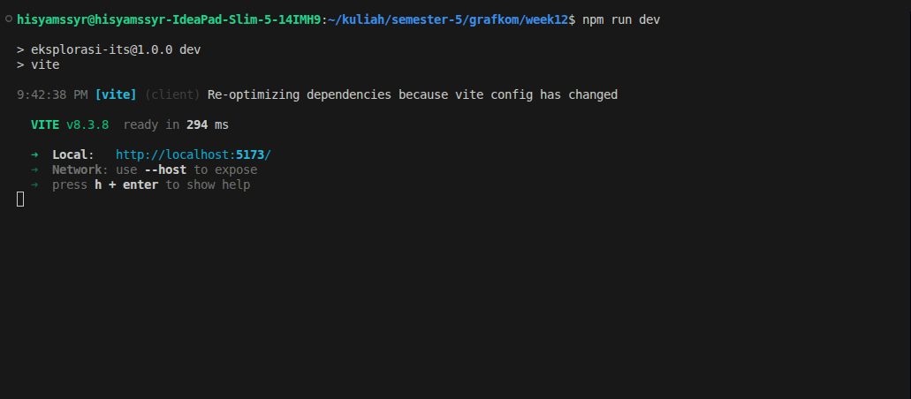

*Gambar 1. `npm run dev` berjalan pada Vite 8.3.8 dan siap di `http://localhost:5173`.*

### 2.1 Konfigurasi multi-halaman dan kode bersama

Sepuluh halaman HTML didaftarkan pada `build.rollupOptions.input` agar seluruh demo ikut
ter-build oleh Vite:

```js
// vite.config.js
build: {
  rollupOptions: {
    input: {
      index: resolve(root, 'index.html'),
      dasar: resolve(root, '01-threejs-dasar.html'),
      pointerlock: resolve(root, '02-pointerlock.html'),
      orbit: resolve(root, '03-orbit.html'),
      gltf: resolve(root, '04-gltf-loader.html'),
      sky: resolve(root, '05-sky.html'),
      instancedmesh: resolve(root, '06-instancedmesh.html'),
      raycaster: resolve(root, '07-raycaster-label.html'),
      tabrakan: resolve(root, '08-tabrakan.html'),
      lilgui: resolve(root, '09-lilgui-stats.html'),
    },
  },
},
```

Renderer, kamera, overlay judul/petunjuk, dan resize handler dibagi lewat `src/common.js`:

```js
export function createRenderer({ shadows = true } = {}) {
  const renderer = new THREE.WebGLRenderer({ antialias: true });
  renderer.setPixelRatio(Math.min(window.devicePixelRatio, 2));
  renderer.setSize(window.innerWidth, window.innerHeight);
  renderer.toneMapping = THREE.ACESFilmicToneMapping;

  if (shadows) {
    renderer.shadowMap.enabled = true;
    renderer.shadowMap.type = THREE.PCFShadowMap;
  }

  document.body.appendChild(renderer.domElement);
  return renderer;
}

export function handleResize(camera, renderer, onResize) {
  window.addEventListener('resize', () => {
    camera.aspect = window.innerWidth / window.innerHeight;
    camera.updateProjectionMatrix();
    renderer.setSize(window.innerWidth, window.innerHeight);
    if (onResize) onResize();
  });
}
```

Dengan pembagian ini, setiap demo hanya berisi kode yang spesifik untuk library yang diuji.

## 3. Hasil percobaan per library

Semua demo dibuka dari halaman indeks (Gambar 2). Tiap bagian berikut memuat tujuan demo,
bukti visual, potongan kode inti, dan hasil pengujian yang diamati.

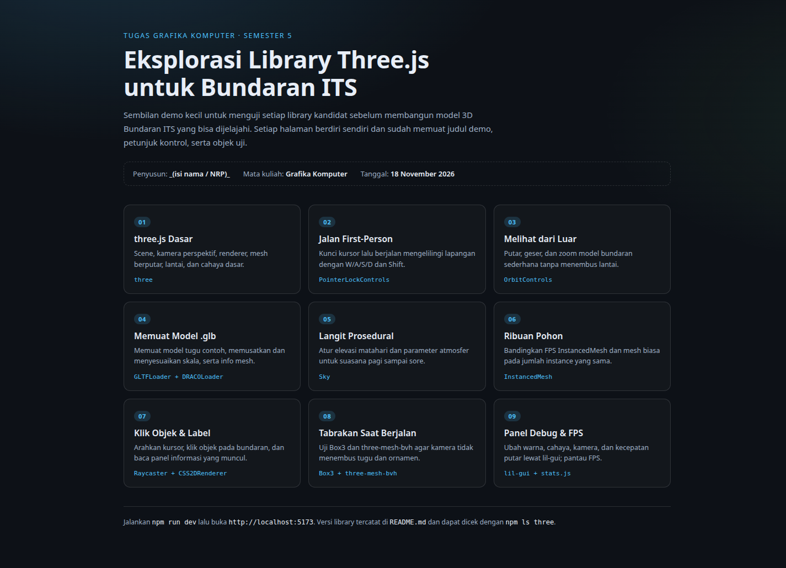

*Gambar 2. Halaman indeks yang menautkan sembilan demo beserta kontrolnya.*

Ringkasan hasil:

| Demo | Library | Hasil singkat | Gambar |
|---|---|---|---|
| 01 | three.js inti | Scene, mesh, cahaya, bayangan, animasi, dan resize berjalan | 3 |
| 02 | PointerLockControls | Jalan first-person dengan WASD, lari, dan tinggi mata tetap | 4–5 |
| 03 | OrbitControls | Putar/geser/zoom dengan batas kamera dan reset | 6–7 |
| 04 | GLTFLoader + DRACOLoader | Model `.glb` termuat, terpusat, dan diskalakan otomatis | 8 |
| 05 | Sky | Langit dan arah matahari berubah sesuai elevasi/azimut | 9–10 |
| 06 | InstancedMesh | 5.000 pohon tetap 60 FPS vs 42–52 FPS pada mesh biasa | 11–13 |
| 07 | Raycaster + CSS2DRenderer | Hover, klik, panel info, dan label mengikuti kamera | 14–15 |
| 08 | Box3 + three-mesh-bvh | Dua metode tabrakan menahan pemain, tetap 60 FPS | 16–18 |
| 09 | lil-gui + stats.js | Panel kontrol dan pemantau FPS/memori, reset berfungsi | 19 |

### 3.1 three.js inti — Demo 01

**Tujuan.** Membuktikan komponen dasar three.js berfungsi: scene, kamera perspektif,
renderer WebGL, mesh, cahaya, bayangan, dan loop animasi.

**Bukti visual.**

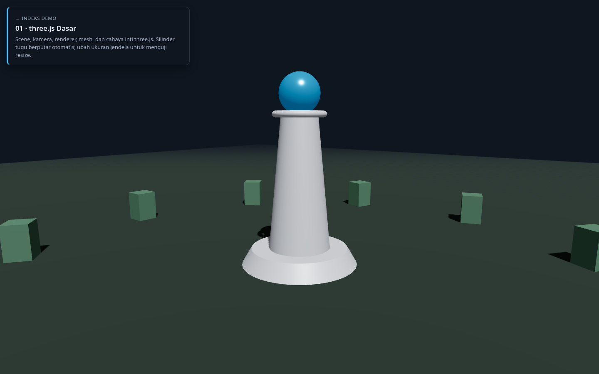

*Gambar 3. Demo 01 — tugu silinder berputar otomatis di atas lantai ber-grid.*

**Potongan kode inti** (`src/01-threejs-dasar.js`):

```js
const scene = new THREE.Scene();
scene.background = new THREE.Color(0x0e1620);
scene.fog = new THREE.Fog(0x0e1620, 30, 80);

const camera = createCamera({ fov: 50, far: 500 });
camera.position.set(7.5, 4.5, 9.5);
camera.lookAt(0, 2.4, 0);

const renderer = createRenderer();
renderer.toneMappingExposure = 1.05;

const ground = createGround(80, 0x33413a);
scene.add(ground);
addBasicLights(scene, { intensity: 2.8, ambient: 0.55 });

const timer = new THREE.Timer();
timer.connect(document);

renderer.setAnimationLoop((timestamp) => {
  timer.update(timestamp);
  const delta = Math.min(timer.getDelta(), 0.05);

  // Mesh berputar dengan kecepatan konstan, tidak bergantung FPS
  tugu.rotation.y += delta * 0.55;
  orb.position.y = 5.3 + Math.sin(timer.getElapsed() * 1.4) * 0.12;

  renderer.render(scene, camera);
});
```

**Hasil.** Objek tampil dengan material dan bayangan yang benar, berputar mulus, dan tetap
proporsional saat ukuran jendela diubah karena `handleResize` memperbarui aspek kamera.
Contoh tampilan dapat dilihat pada Gambar 3.

### 3.2 PointerLockControls — Demo 02

**Tujuan.** Menguji mode berjalan first-person sebagai inti fitur “Bundaran ITS bisa
dijelajahi”.

**Bukti visual.**

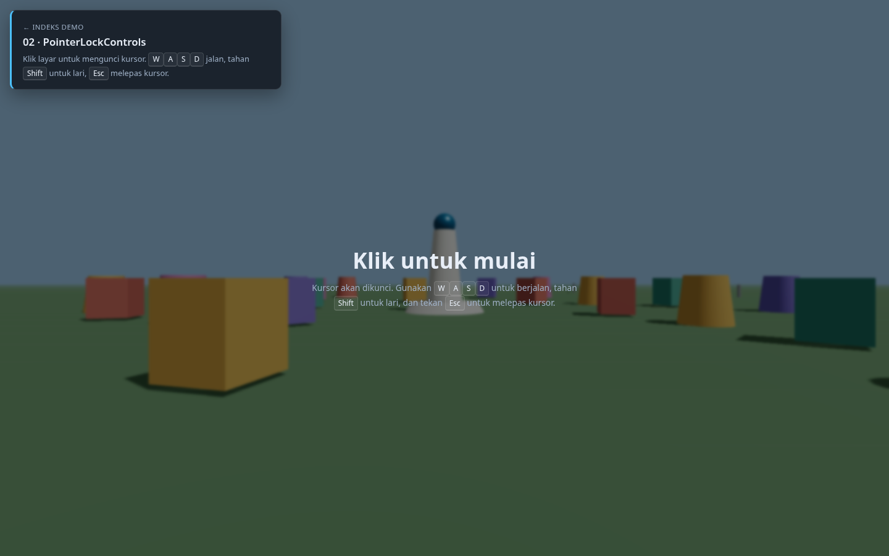

*Gambar 4. Overlay “Klik untuk mulai” sebelum kursor dikunci.*

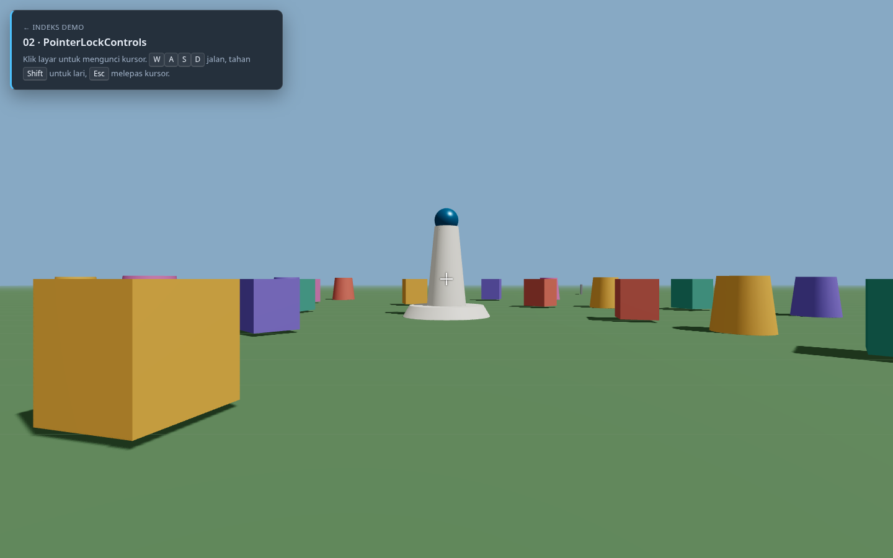

*Gambar 5. Tampilan first-person dengan crosshair setelah kursor terkunci.*

**Potongan kode inti** (`src/02-pointerlock.js`):

```js
const controls = new PointerLockControls(camera, renderer.domElement);

renderer.domElement.addEventListener('click', () => {
  if (!controls.isLocked) controls.lock();
});

controls.addEventListener('lock', () => {
  document.body.classList.add('locked');
  startPrompt.classList.add('hidden');
});

controls.addEventListener('unlock', () => {
  document.body.classList.remove('locked');
  startPrompt.classList.remove('hidden');
});

renderer.setAnimationLoop((timestamp) => {
  timer.update(timestamp);
  const delta = Math.min(timer.getDelta(), 0.05);

  if (controls.isLocked) {
    camera.getWorldDirection(forward);
    forward.y = 0;
    forward.normalize();
    right.crossVectors(forward, camera.up).normalize();

    desired.set(0, 0, 0);
    if (keys.has('KeyW')) desired.add(forward);
    if (keys.has('KeyS')) desired.sub(forward);
    if (keys.has('KeyD')) desired.add(right);
    if (keys.has('KeyA')) desired.sub(right);

    const running = keys.has('ShiftLeft') || keys.has('ShiftRight');
    const speed = running ? RUN_SPEED : WALK_SPEED;
    if (desired.lengthSq() > 0) desired.normalize().multiplyScalar(speed);

    velocity.lerp(desired, 1 - Math.exp(-12 * delta));
    camera.position.addScaledVector(velocity, delta);
    camera.position.y = EYE_HEIGHT;
  }

  renderer.render(scene, camera);
});
```

**Hasil.** Kursor terkunci setelah klik dan `Esc` mengembalikan overlay. `W/A/S/D` bergerak
sesuai arah pandang, `Shift` menaikkan kecepatan dari 4,2 menjadi 8,0 satuan/detik, dan
tinggi mata tetap 1,7 satuan sehingga kamera tidak melayang. Gerak memakai delta time agar
konsisten di berbagai FPS.

### 3.3 OrbitControls — Demo 03

**Tujuan.** Menguji mode inspeksi dari luar sebagai pelengkap mode berjalan.

**Bukti visual.**

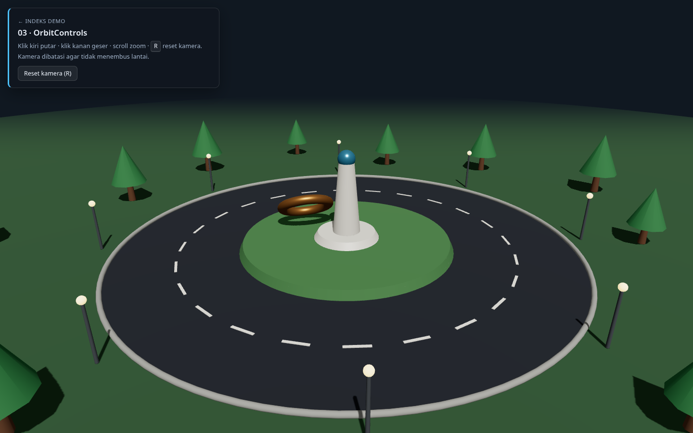

*Gambar 6. Bundaran sederhana dilihat dari samping.*

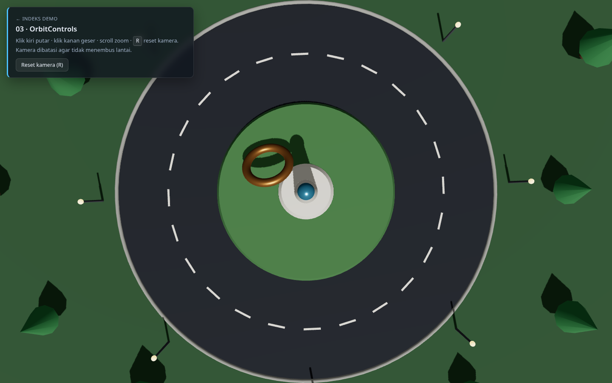

*Gambar 7. Sudut pandang atas setelah kamera diputar dan di-zoom.*

**Potongan kode inti** (`src/03-orbit.js`):

```js
const controls = new OrbitControls(camera, renderer.domElement);
controls.target.copy(HOME_TARGET);
controls.enableDamping = true;
controls.dampingFactor = 0.08;
controls.minDistance = 9;
controls.maxDistance = 48;
controls.maxPolarAngle = Math.PI / 2 - 0.06;
controls.update();

function resetCamera() {
  camera.position.copy(HOME_POSITION);
  controls.target.copy(HOME_TARGET);
  controls.update();
}

window.addEventListener('keydown', (event) => {
  if (event.code === 'KeyR') resetCamera();
});

renderer.setAnimationLoop((timestamp) => {
  timer.update(timestamp);
  const delta = Math.min(timer.getDelta(), 0.05);

  ringOrnament.rotation.z += delta * 0.35;

  controls.update();
  renderer.render(scene, camera);
});
```

**Hasil.** Klik kiri memutar, klik kanan menggeser, dan scroll memperbesar/mengecilkan.
Damping membuat gerakan halus. `minDistance`, `maxDistance`, dan `maxPolarAngle` membatasi
kamera agar tidak menembus lantai. Tombol `R` atau tombol “Reset kamera” mengembalikan
posisi awal.

### 3.4 GLTFLoader + DRACOLoader — Demo 04

**Tujuan.** Menguji pemuatan model `.glb` hasil ekspor Blender, termasuk decoder Draco dan
penyesuaian skala otomatis.

**Bukti visual.**

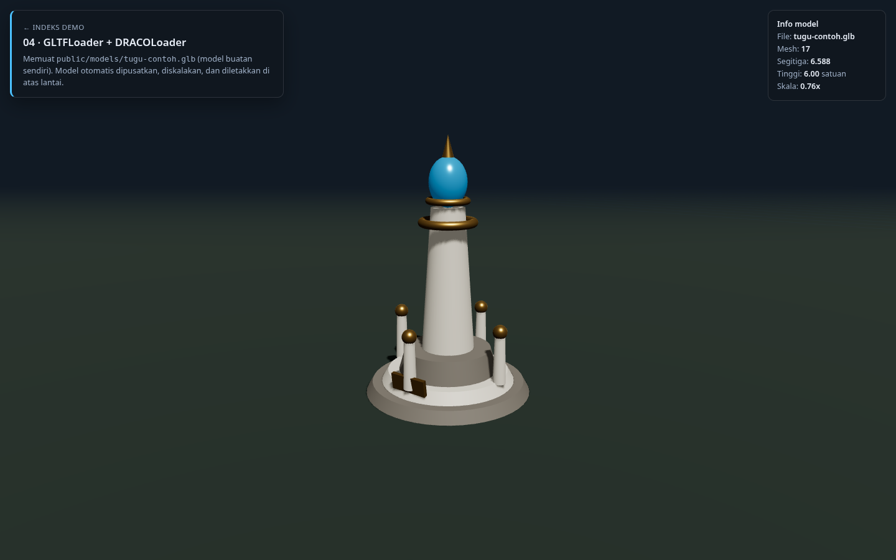

*Gambar 8. Model `tugu-contoh.glb` tampil bersama HUD jumlah mesh dan segitiga.*

**Potongan kode inti** (`src/04-gltf-loader.js`):

```js
const dracoLoader = new DRACOLoader();
dracoLoader.setDecoderPath(`${import.meta.env.BASE_URL}draco/`);

const loader = new GLTFLoader();
loader.setDRACOLoader(dracoLoader);

const modelUrl = `${import.meta.env.BASE_URL}models/tugu-contoh.glb`;

loader.load(
  modelUrl,
  (gltf) => {
    const model = gltf.scene;

    const originalBox = new THREE.Box3().setFromObject(model);
    const originalSize = new THREE.Vector3();
    originalBox.getSize(originalSize);

    const targetHeight = 6;
    const scale = targetHeight / (originalSize.y || 1);
    model.scale.setScalar(scale);
    model.updateMatrixWorld(true);

    const scaledBox = new THREE.Box3().setFromObject(model);
    const scaledCenter = new THREE.Vector3();
    scaledBox.getCenter(scaledCenter);

    model.position.x -= scaledCenter.x;
    model.position.z -= scaledCenter.z;
    model.position.y -= scaledBox.min.y;
    scene.add(model);

    // ... HUD jumlah mesh/segitiga dan target OrbitControls
  },
  // ... indikator progres dan penanganan error
);
```

**Hasil.** Model termuat dengan material aslinya, otomatis dipusatkan, dan diskalakan menjadi
tinggi 6 satuan. HUD menampilkan 17 mesh dan 6.588 segitiga. Decoder Draco disimpan lokal di
`public/draco/` sehingga tidak bergantung CDN. Bila file hilang, muncul kotak error yang
menjelaskan cara membuat ulang model, bukan layar kosong.

### 3.5 Sky — Demo 05

**Tujuan.** Menguji langit dan matahari prosedural untuk suasana siang/sore, serta
sinkronisasi arah cahaya dengan posisi matahari.

**Bukti visual.**

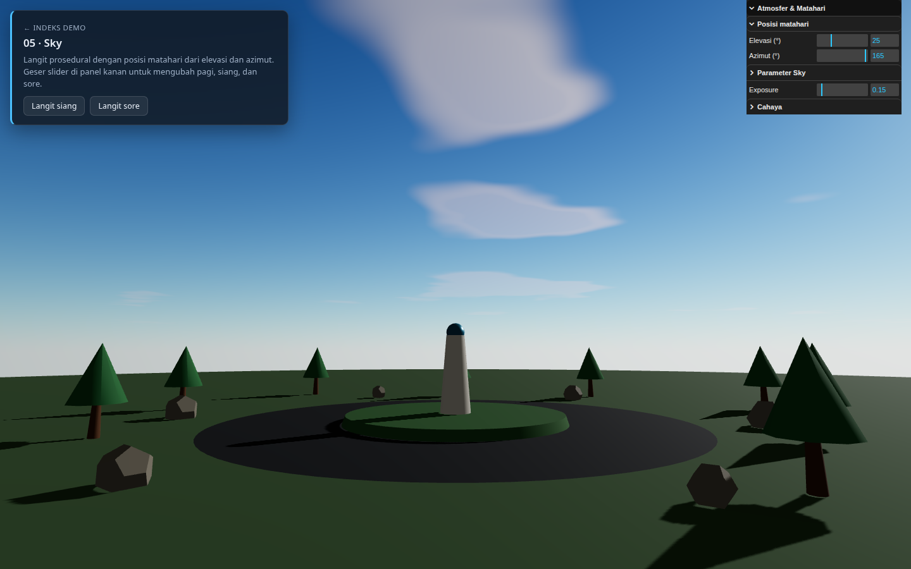

*Gambar 9. Preset “Langit siang” dengan langit biru dan bayangan pendek.*

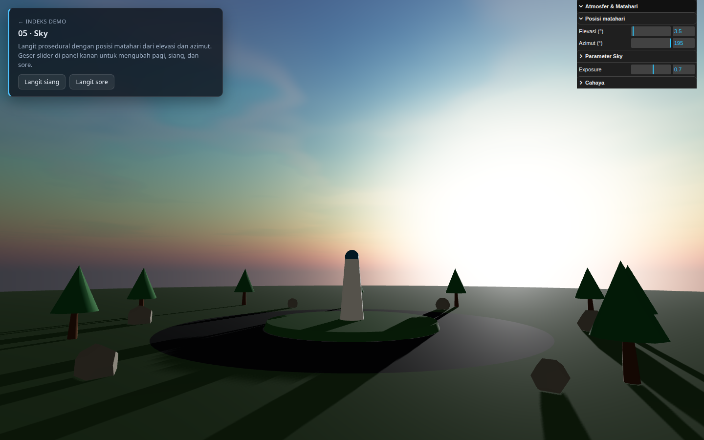

*Gambar 10. Preset “Langit sore” dengan warna lebih hangat dan bayangan memanjang.*

**Potongan kode inti** (`src/05-sky.js`):

```js
function updateAtmosphere() {
  const uniforms = sky.material.uniforms;
  uniforms.turbidity.value = params.turbidity;
  uniforms.rayleigh.value = params.rayleigh;
  uniforms.mieCoefficient.value = params.mieCoefficient;
  uniforms.mieDirectionalG.value = params.mieDirectionalG;
  uniforms.cloudCoverage.value = params.cloudCoverage;
  uniforms.cloudDensity.value = params.cloudDensity;

  // Elevasi 90° = matahari tepat di atas; azimut menentukan arah horizontal
  const phi = THREE.MathUtils.degToRad(90 - params.elevation);
  const theta = THREE.MathUtils.degToRad(params.azimuth);
  sunPosition.setFromSphericalCoords(1, phi, theta);
  uniforms.sunPosition.value.copy(sunPosition);

  // DirectionalLight disinkronkan dengan posisi matahari
  sunLight.position.copy(sunPosition).multiplyScalar(120);
  sunLight.target.position.set(0, 0, 0);
  sunLight.target.updateMatrixWorld();

  sunLight.intensity = params.sunIntensity;
  ambientLight.intensity = params.ambientIntensity;
  renderer.toneMappingExposure = params.exposure;
}
```

**Hasil.** Menggeser elevasi dan azimut mengubah langit serta arah bayangan secara halus.
Preset siang dan sore memudahkan pengambilan bukti. Tone mapping ACES Filmic dan exposure
dapat diatur dari panel; versi three r187 juga menambahkan parameter awan prosedural.

### 3.6 InstancedMesh — Demo 06

**Tujuan.** Menguji performa banyak objek serupa (pohon) dan membandingkannya dengan mesh
biasa pada jumlah yang sama.

**Bukti visual.**

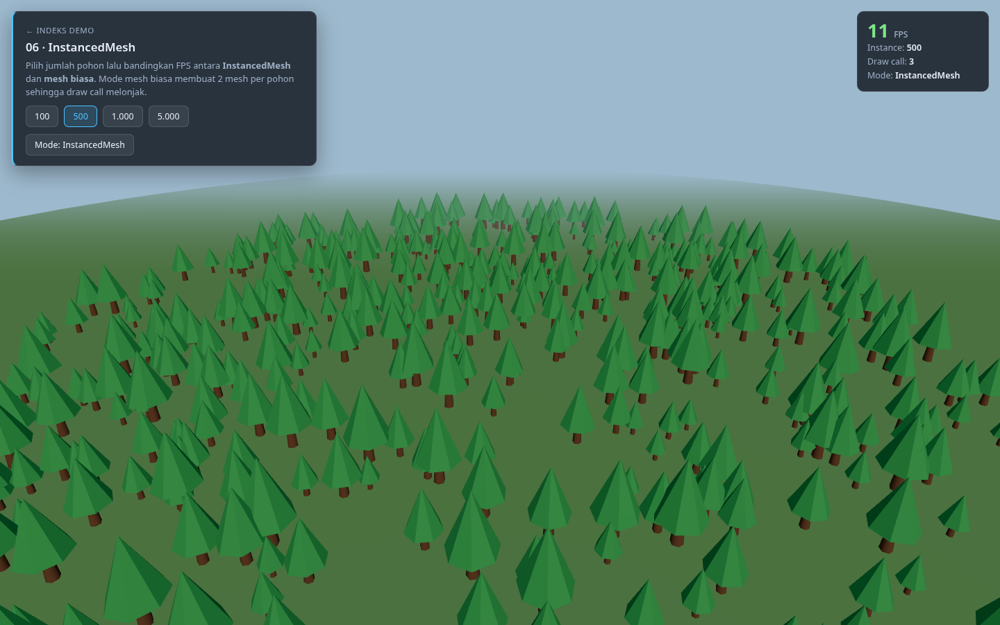

*Gambar 11. 500 pohon, mode InstancedMesh, 3 draw call.*

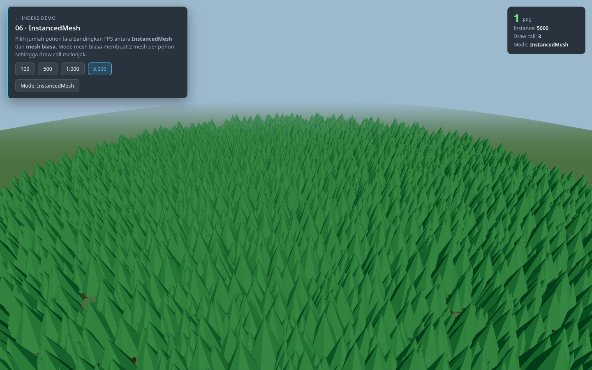

*Gambar 12. 5.000 pohon, mode InstancedMesh, tetap 3 draw call.*


*Gambar 13. Pembanding 5.000 pohon dengan mesh biasa; draw call melonjak.*

**Potongan kode inti** (`src/06-instancedmesh.js`):

```js
if (mode === 'instanced') {
  instancedTrunks = new THREE.InstancedMesh(trunkGeometry, trunkMaterial, count);
  instancedCrowns = new THREE.InstancedMesh(crownGeometry, crownMaterial, count);

  for (let i = 0; i < count; i += 1) {
    const tree = trees[i];
    dummy.position.set(tree.x, 0, tree.z);
    dummy.rotation.set(0, tree.rotation, 0);
    dummy.scale.setScalar(tree.scale);
    dummy.updateMatrix();
    instancedTrunks.setMatrixAt(i, dummy.matrix);
    instancedCrowns.setMatrixAt(i, dummy.matrix);
  }

  instancedTrunks.instanceMatrix.needsUpdate = true;
  instancedCrowns.instanceMatrix.needsUpdate = true;
  scene.add(instancedTrunks, instancedCrowns);
} else {
  normalGroup = new THREE.Group();
  for (let i = 0; i < count; i += 1) {
    const tree = trees[i];
    const trunk = new THREE.Mesh(trunkGeometry, trunkMaterial);
    const crown = new THREE.Mesh(crownGeometry, crownMaterial);
    // ... posisi, rotasi, dan skala tiap pohon
    normalGroup.add(trunk, crown);
  }
  scene.add(normalGroup);
}
```

**Hasil.** Tombol 100/500/1.000/5.000 dan tombol mode bekerja langsung. Pada laptop
penyusun, 500 dan 5.000 pohon mode InstancedMesh berjalan 60 FPS dengan 3 draw call,
sedangkan 5.000 pohon mesh biasa membutuhkan 9.606 draw call dan turun ke 42–52 FPS.
Perbandingan lengkap ada pada tabel Bagian 7.

### 3.7 Raycaster + CSS2DRenderer — Demo 07

**Tujuan.** Menguji interaksi klik objek dan label informasi, misalnya keterangan Tugu ITS.

**Bukti visual.**

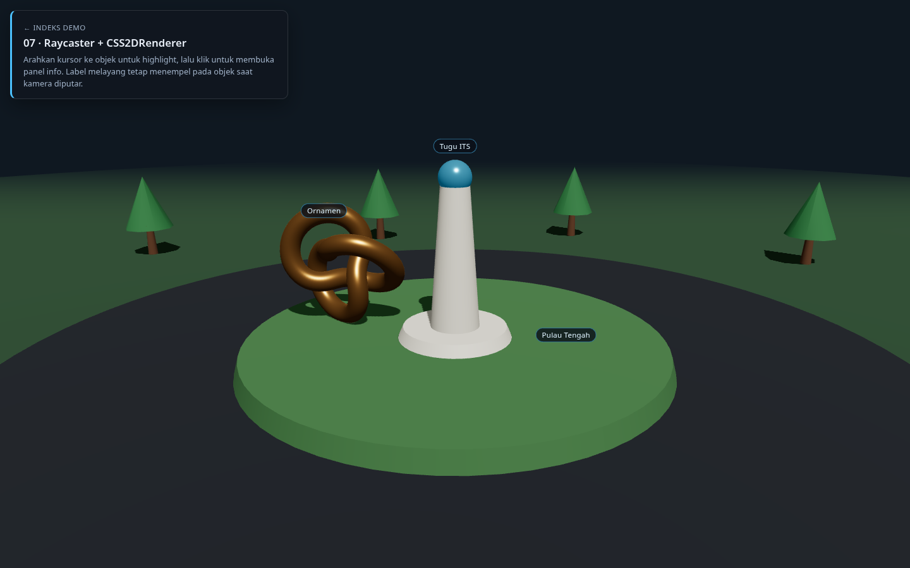

*Gambar 14. Label “Tugu ITS”, “Pulau Tengah”, dan “Ornamen” melayang di atas objek.*

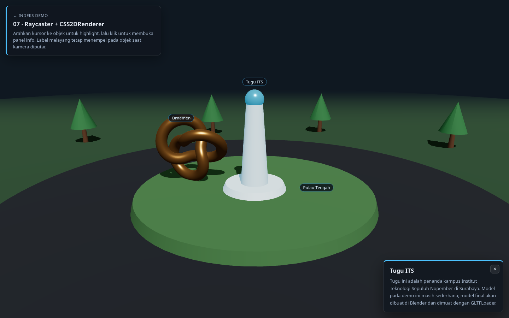

*Gambar 15. Panel info terbuka setelah Tugu ITS diklik.*

**Potongan kode inti** (`src/07-raycaster-label.js`):

```js
const labelRenderer = new CSS2DRenderer();
labelRenderer.setSize(window.innerWidth, window.innerHeight);
document.body.appendChild(labelRenderer.domElement);

const raycaster = new THREE.Raycaster();
const pointer = new THREE.Vector2();
const clickables = [tugu, island, ornament];

function pick(event) {
  const rect = renderer.domElement.getBoundingClientRect();
  pointer.x = ((event.clientX - rect.left) / rect.width) * 2 - 1;
  pointer.y = -((event.clientY - rect.top) / rect.height) * 2 + 1;
  raycaster.setFromCamera(pointer, camera);

  const intersections = raycaster.intersectObjects(clickables, true);
  if (intersections.length === 0) return null;

  let object = intersections[0].object;
  while (object && !object.userData.info) object = object.parent;
  return object || null;
}

renderer.setAnimationLoop((timestamp) => {
  timer.update(timestamp);
  const delta = Math.min(timer.getDelta(), 0.05);

  ornament.rotation.y += delta * 0.35;
  controls.update();
  renderer.render(scene, camera);

  // Label ikut kamera setiap frame
  labelRenderer.render(scene, camera);
});
```

**Hasil.** Hover mengubah warna objek dan kursor menjadi pointer. Klik membuka panel info
sesuai objek yang dipilih; klik yang sebenarnya drag diabaikan lewat ambang jarak 5 piksel.
Label CSS2D tetap menempel pada objek saat kamera diputar dan teksnya tetap tajam karena
memakai elemen HTML.

### 3.8 Box3 + three-mesh-bvh — Demo 08

**Tujuan.** Menguji dua metode tabrakan agar pemain tidak menembus tugu, tembok, pot, dan
ornamen saat berjalan.

**Bukti visual.**

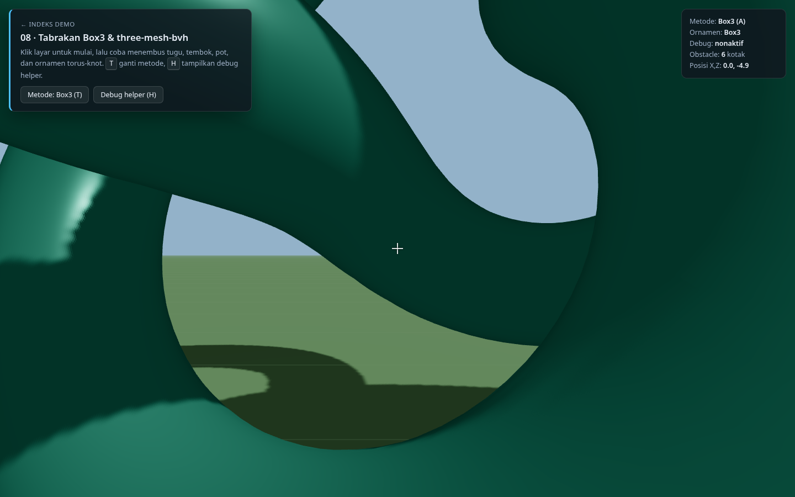

*Gambar 16. Pemain tertahan di depan ornamen saat mencoba menembus.*

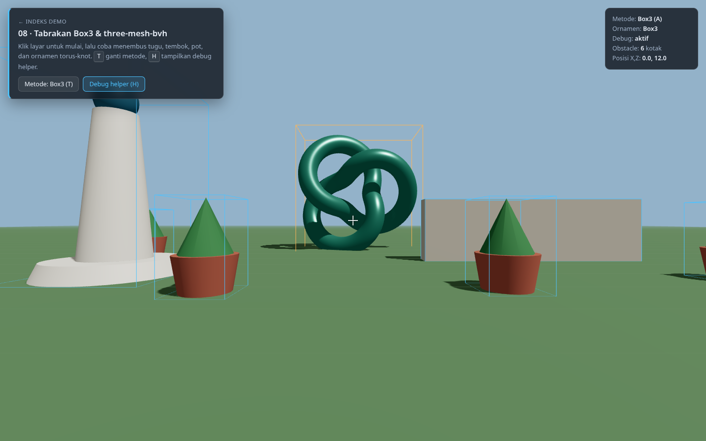

*Gambar 17. Kotak tabrakan Box3 ditampilkan sebagai debug helper.*

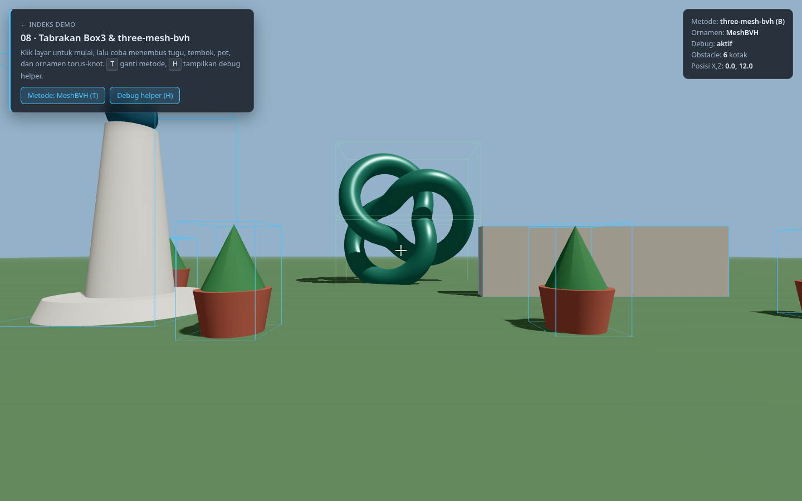

*Gambar 18. Visualisasi BVH pada metode three-mesh-bvh.*

**Potongan kode inti** (`src/08-tabrakan.js`):

```js
THREE.BufferGeometry.prototype.computeBoundsTree = computeBoundsTree;
THREE.BufferGeometry.prototype.disposeBoundsTree = disposeBoundsTree;
THREE.Mesh.prototype.raycast = acceleratedRaycast;

const complexGeometry = new THREE.TorusKnotGeometry(2.2, 0.55, 256, 32, 2, 3);
complexGeometry.computeBoundsTree();

function canMoveTo(nextX, nextZ, fromX, fromZ) {
  if (hitsBox3(nextX, nextZ)) return false;

  if (method === 'bvh') {
    const dx = nextX - fromX;
    const dz = nextZ - fromZ;
    const distance = Math.hypot(dx, dz);
    if (distance > 0.0001) {
      if (hitsComplexWithBVH(fromX, fromZ, dx / distance, dz / distance, distance)) {
        return false;
      }
    }
  }

  return true;
}

// Uji sumbu X dan Z terpisah supaya pemain bisa menyusur dinding
const nextX = camera.position.x + desired.x;
if (canMoveTo(nextX, camera.position.z, camera.position.x, camera.position.z)) {
  camera.position.x = nextX;
}

const nextZ = camera.position.z + desired.z;
if (canMoveTo(camera.position.x, nextZ, camera.position.x, camera.position.z)) {
  camera.position.z = nextZ;
}
```

**Hasil.** Metode A (`Box3`) menahan pemain pada posisi Z ≈ -4,9 di depan ornamen;
metode B (BVH) memungkinkan pemain mendekat sedikit lebih jauh (Z ≈ -5,1) karena bentuk
permukaan torus-knot lebih presisi daripada kotak pembatas. Kedua metode mencegah kamera
menembus obstacle, dan gerak per sumbu memungkinkan pemain menyusur dinding. Tombol `T`
mengganti metode, `H` menampilkan debug helper, dan scene uji stabil di 60 FPS.

### 3.9 lil-gui + stats.js — Demo 09

**Tujuan.** Menguji panel kontrol dan pemantau performa sebagai alat bantu pengembangan.

**Bukti visual.**

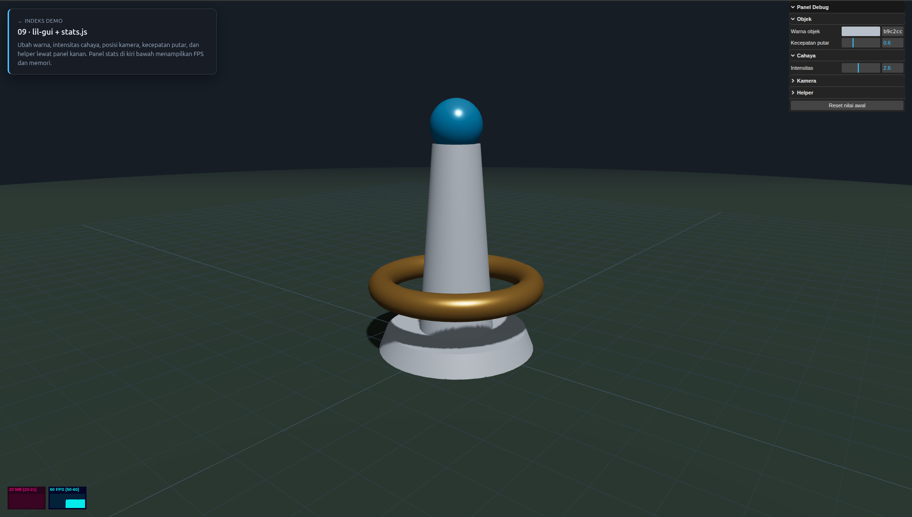

*Gambar 19. Panel lil-gui di kanan dan stats.js di kiri bawah; FPS 60 (50–60), memori 20 MB.*

**Potongan kode inti** (`src/09-lilgui-stats.js`):

```js
const gui = new GUI({ title: 'Panel Debug' });

objectFolder
  .addColor(params, 'color')
  .name('Warna objek')
  .onChange((value) => objectMaterial.color.set(value));
objectFolder.add(params, 'rotationSpeed', 0, 2, 0.01).name('Kecepatan putar');

lightFolder
  .add(params, 'lightIntensity', 0, 6, 0.05)
  .name('Intensitas')
  .onChange((value) => {
    directionalLight.intensity = value;
  });

const actions = { reset: resetAll };
gui.add(actions, 'reset').name('Reset nilai awal');

const statsFps = new Stats();
statsFps.showPanel(0);
document.body.appendChild(statsFps.dom);

const statsMemory = new Stats();
if (statsMemory.dom.children.length > 2) {
  statsMemory.showPanel(2);
  document.body.appendChild(statsMemory.dom);
}

renderer.setAnimationLoop((timestamp) => {
  timer.update(timestamp);
  statsFps.begin();
  statsMemory.begin();

  const delta = Math.min(timer.getDelta(), 0.05);
  objectGroup.rotation.y += delta * params.rotationSpeed;
  camera.lookAt(cameraTarget);
  renderer.render(scene, camera);

  statsFps.end();
  statsMemory.end();
});
```

**Hasil.** Perubahan warna, intensitas cahaya, posisi kamera, kecepatan putar, serta
visibilitas grid/axes langsung terlihat di scene. Panel FPS dan memori selalu tampil;
tombol “Reset nilai awal” mengembalikan semua parameter. Di laptop penyusun, screenshot
menunjukkan 60 FPS (50–60) dengan pemakaian memori 20 MB (Gambar 19).

## 4. Tabel perbandingan

Skor 1 = sulit/buruk, 5 = mudah/sangat baik. Penilaian berdasarkan pengalaman selama
eksplorasi dan kebutuhan proyek Bundaran ITS.

| Library | Kemudahan (1-5) | Performa (1-5) | Dokumentasi (1-5) | Wajib untuk proyek utama? | Catatan |
|---|---:|---:|---:|---|---|
| three.js inti | 5 | 5 | 5 | Ya | Fondasi renderer, scene, kamera, mesh, cahaya, dan animasi. |
| PointerLockControls | 5 | 5 | 5 | Ya | Inti fitur berjalan first-person; cukup klik untuk mengunci kursor. Perlu HTTPS/localhost. |
| OrbitControls | 5 | 5 | 5 | Ya | Pelengkap mode melihat objek dari luar; damping dan batas kamera mudah diatur. |
| GLTFLoader + Draco | 4 | 4 | 5 | Ya | Wajib untuk model Blender. Decoder perlu disiapkan lokal; model uji tidak memakai kompresi Draco tetapi loader sudah terkonfigurasi. |
| Sky | 4 | 4 | 4 | Ya (untuk suasana outdoor) | Memberi langit dan matahari prosedural. Perlu penyetelan exposure agar langit siang tidak terlalu pucat. |
| InstancedMesh | 4 | 5 | 4 | Ya | Sangat efektif untuk pohon, lampu, dan kendaraan dalam jumlah banyak. Perlu mengatur matriks per instance. |
| Raycaster + CSS2DRenderer | 4 | 4 | 4 | Ya | Interaksi klik dan label info mudah dipakai; label HTML tetap terbaca tajam. |
| Box3 / three-mesh-bvh | 3 | 4 | 4 | Ya | Box3 cukup untuk obstacle sederhana; BVH diperlukan untuk geometri kompleks. Implementasi tabrakan pemain perlu logika tambahan (sliding). |
| lil-gui + stats.js | 5 | 5 | 4 | Tidak (alat bantu dev) | Sangat membantu saat mengatur parameter dan memantau FPS; tidak perlu dimasukkan ke build final. |

## 5. Pengamatan penting

1. **Performa InstancedMesh.** Pada 5.000 pohon, mode InstancedMesh hanya membutuhkan
   3 draw call dan tetap 60 FPS di laptop penyusun, sedangkan mode mesh biasa membutuhkan
   9.606 draw call dan turun ke 42–52 FPS. Perbedaan draw call ini adalah alasan utama
   InstancedMesh dipilih untuk vegetasi dan lampu.
2. **Tabrakan.** Dengan Box3, pemain berhenti pada posisi Z ≈ -4,9 di depan ornamen.
   Dengan BVH, pemain dapat mendekat sedikit lebih jauh (Z ≈ -5,1) karena bentuk permukaan
   torus-knot lebih presisi daripada kotak pembatas. Kedua metode berhasil mencegah
   kamera menembus obstacle.
3. **Sky.** Langit siang memerlukan penurunan exposure dan pemilihan elevasi matahari
   yang tepat agar tidak tampak putih. Preset sore memperlihatkan perubahan warna dan arah
   bayangan yang jelas.
4. **Label CSS2D.** Label memakai elemen HTML sehingga kualitas teks tetap tajam dan
   mudah ditata dengan CSS; posisinya diperbarui setiap frame bersama kamera.
5. **Pointer Lock.** Demo berjalan di `localhost`; kursor dapat dilepas dengan Esc dan
   overlay "Klik untuk mulai" muncul kembali.

## 6. Rekomendasi library final

**Wajib dipakai di proyek Bundaran ITS:**

- `three` (inti) — fondasi seluruh scene.
- `PointerLockControls` — mode berjalan first-person.
- `OrbitControls` — mode inspeksi dari luar.
- `GLTFLoader` + `DRACOLoader` — memuat aset `.glb` hasil Blender.
- `InstancedMesh` — pohon, lampu, dan kendaraan dalam jumlah besar.
- `Raycaster` + `CSS2DRenderer` — interaksi klik dan label informasi.
- `Box3` dan `three-mesh-bvh` — tabrakan obstacle sederhana dan kompleks.
- `Sky` — suasana langit siang/sore.

**Hanya untuk pengembangan (tidak masuk build final):**

- `lil-gui` dan `stats.js` — mempercepat penyetelan parameter dan pemantauan FPS.

**Alasan ringkas.** Kombinasi ini sudah mencakup seluruh kebutuhan inti: render, jalan
first-person, inspeksi objek, pemuatan model, performa untuk objek berulang, interaksi
informasi, tabrakan, dan suasana. Semua library berjalan baik dengan three.js 0.187 dan
tidak menambah dependensi di luar daftar PRD.

## 7. Tabel performa

Diukur di laptop penyusun (Intel Core Ultra 7 155H + Intel Arc Graphics) memakai Chrome 156
headless dengan ANGLE OpenGL pada jendela 1600 × 900. Angka FPS adalah hasil pembacaan HUD
dan pengukuran `requestAnimationFrame` selama 2 detik.

| Kondisi | Draw call (terukur) | FPS di GPU laptop | Catatan |
|---|---:|---:|---|
| 06 — 500 pohon, InstancedMesh | 3 | 60 | Target 60 FPS tercapai |
| 06 — 5.000 pohon, InstancedMesh | 3 | 60 | Uji beban; FPS tetap stabil |
| 06 — 5.000 pohon, mesh biasa | 9.606 | 42–52 | Pembanding; HUD 42 FPS, rata-rata rAF 52 FPS |
| 08 — Box3/BVH | — | 60 | Scene uji kecil; tidak ada penurunan FPS |
| 09 — lil-gui + stats.js | — | 60 | Diukur di laptop penyusun; memori 20 MB |

## 8. Daftar gambar

Seluruh gambar berikut sudah disisipkan pada bagian yang relevan.

| Gambar | File | Isi | Letak |
|---|---|---|---|
| 1 | `screenshots/00-terminal-dev.png` | Terminal `npm run dev` berhasil (Vite ready 294 ms) | Bagian 2 |
| 2 | `screenshots/00-indeks.png` | Halaman indeks seluruh demo | Bagian 3 |
| 3 | `screenshots/01-dasar.png` | Demo 01: three.js dasar | Bagian 3.1 |
| 4 | `screenshots/02-overlay-awal.png` | Demo 02: overlay “Klik untuk mulai” | Bagian 3.2 |
| 5 | `screenshots/02-pointerlock.png` | Demo 02: tampilan first-person | Bagian 3.2 |
| 6 | `screenshots/03-orbit-samping.png` | Demo 03: sudut pandang samping | Bagian 3.3 |
| 7 | `screenshots/03-orbit-atas.png` | Demo 03: sudut pandang atas | Bagian 3.3 |
| 8 | `screenshots/04-gltf.png` | Demo 04: model `.glb` dan info mesh | Bagian 3.4 |
| 9 | `screenshots/05-sky-siang.png` | Demo 05: langit siang | Bagian 3.5 |
| 10 | `screenshots/05-sky-sore.png` | Demo 05: langit sore | Bagian 3.5 |
| 11 | `screenshots/06-instanced-500.png` | Demo 06: 500 pohon, InstancedMesh | Bagian 3.6 |
| 12 | `screenshots/06-instanced-5000.png` | Demo 06: 5.000 pohon, InstancedMesh | Bagian 3.6 |
| 13 | `screenshots/06-mesh-biasa-5000.png` | Demo 06: pembanding mesh biasa | Bagian 3.6 |
| 14 | `screenshots/07-label.png` | Demo 07: label CSS2D | Bagian 3.7 |
| 15 | `screenshots/07-panel-info.png` | Demo 07: panel info objek | Bagian 3.7 |
| 16 | `screenshots/08-tabrakan.png` | Demo 08: kamera tertahan | Bagian 3.8 |
| 17 | `screenshots/08-tabrakan-debug.png` | Demo 08: debug helper Box3 | Bagian 3.8 |
| 18 | `screenshots/08-tabrakan-bvh-debug.png` | Demo 08: visualisasi BVH | Bagian 3.8 |
| 19 | `screenshots/09-gui-stats.png` | Demo 09: lil-gui dan stats.js (60 FPS) | Bagian 3.9 |

Gambar 1 dan 19 diambil manual di laptop penyusun; gambar lainnya adalah baseline otomatis
headless. Jika bar alamat wajib terlihat pada semua tangkapan, gambar baseline perlu diambil
ulang di browser laptop. Potongan kode inti setiap library sudah disertakan pada Bagian 3.

## 9. Kendala dan mitigasi

| Kendala | Mitigasi yang dilakukan |
|---|---|
| Decoder Draco membutuhkan berkas tambahan | Decoder disalin ke `public/draco/` dan dimuat lewat `setDecoderPath`; tidak bergantung CDN. |
| Model `.glb` tidak tersedia | Model contoh dibuat sendiri lewat `tools/make-model.mjs`; loader tetap menangani error bila file hilang. |
| Langit siang terlalu pucat | Exposure diturunkan, elevasi matahari diatur, dan awan prosedural dikurangi. |
| Tabrakan BVH memerlukan geometri khusus | `computeBoundsTree()` dipanggil pada torus-knot; raycast diarahkan untuk beberapa ketinggian badan pemain. |
| FPS headless tidak representatif | Screenshot baseline memakai SwiftShader; pengukuran FPS diulang memakai Chrome headless + ANGLE OpenGL pada GPU Intel Arc, sehingga angka pada Bagian 7 representatif. |
| Pointer Lock ditolak browser | Demo dijalankan lewat `localhost` dan menunggu klik pengguna sebelum mengunci kursor. |

## 10. Kesimpulan

Seluruh sembilan demo berhasil dijalankan tanpa error konsol pada build produksi. Semua
kriteria inti terpenuhi: Three.js inti berfungsi, first-person berjalan, orbit berfungsi,
model `.glb` termuat, langit berubah, InstancedMesh menunjukkan keunggulan draw call,
Raycaster/CSS2D menampilkan label dan panel, kedua metode tabrakan menahan pemain, dan
panel debug berfungsi. Pengukuran di laptop penyusun menunjukkan InstancedMesh tetap
60 FPS pada 500 dan 5.000 pohon, mesh biasa 5.000 pohon turun ke 42–52 FPS dengan 9.606
draw call, demo 08 stabil 60 FPS, dan demo 09 mencatat 60 FPS (50–60) dengan memori 20 MB.
Daftar library final untuk proyek Bundaran ITS sudah ditentukan pada Bagian 6.
