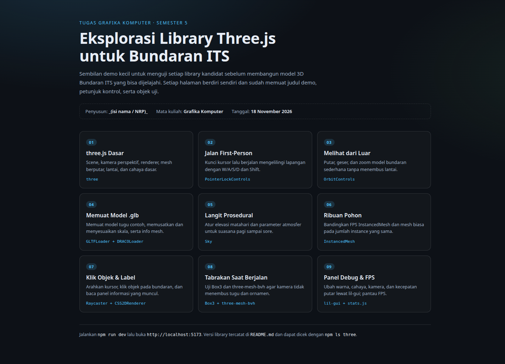

# Eksplorasi Library Three.js — Bundaran ITS

Proyek eksplorasi sembilan library pendukung Three.js untuk persiapan pembuatan model 3D
Bundaran ITS yang dapat dijelajahi. Semua demo berada dalam satu proyek Vite multi-halaman.



## Menjalankan

Prasyarat: Node.js 20 atau lebih baru (diuji dengan Node.js v22.22.1) dan npm.

```bash
npm install
npm run dev       # http://localhost:5173
```

Perintah lain:

```bash
npm run build     # hasil produksi di folder dist/
npm run preview   # menjalankan hasil build
npm run make-model # membuat ulang public/models/tugu-contoh.glb
```

## Versi

| Komponen | Versi |
|---|---|
| Node.js | v22.22.1 (minimal v20) |
| Vite | 8.3.8 |
| three.js | 0.187.0 |
| three-mesh-bvh | 0.9.18 |
| lil-gui | 0.21.0 |
| stats.js | 0.17.0 |
| Laptop uji | Lenovo IdeaPad Slim 5 14IMH9 (Intel Core Ultra 7 155H, Intel Arc Graphics, RAM 16 GB) |

Versi aktual dapat dicek dengan `npm ls three three-mesh-bvh lil-gui stats.js vite`.

## Daftar demo dan kontrol

| No | Halaman | Library yang diuji | Kontrol |
|---|---|---|---|
| 01 | `01-threejs-dasar.html` | three.js inti | Otomatis; ubah ukuran jendela untuk menguji resize |
| 02 | `02-pointerlock.html` | PointerLockControls | Klik layar, `W`/`A`/`S`/`D` jalan, `Shift` lari, `Esc` lepas kursor |
| 03 | `03-orbit.html` | OrbitControls | Klik kiri putar, klik kanan geser, scroll zoom, `R` reset kamera |
| 04 | `04-gltf-loader.html` | GLTFLoader + DRACOLoader | Klik kiri putar, klik kanan geser, scroll zoom |
| 05 | `05-sky.html` | Sky | Slider panel kanan + tombol preset "Langit siang" / "Langit sore" |
| 06 | `06-instancedmesh.html` | InstancedMesh | Tombol jumlah instance dan tombol mode (InstancedMesh / mesh biasa) |
| 07 | `07-raycaster-label.html` | Raycaster + CSS2DRenderer | Arahkan kursor, klik objek, `Esc` tutup panel; orbit seperti demo 03 |
| 08 | `08-tabrakan.html` | Box3 + three-mesh-bvh | Klik layar, `WASD`, `Shift`, `T` ganti metode tabrakan, `H` debug helper, `Esc` |
| 09 | `09-lilgui-stats.html` | lil-gui + stats.js | Panel GUI kanan; tombol "Reset nilai awal"; stats di kiri bawah |

## Struktur

```text
.
├── index.html                  # menu semua demo
├── 01..09-*.html               # satu halaman per demo
├── public/
│   ├── draco/                  # decoder DRACO lokal (dari paket three)
│   ├── models/tugu-contoh.glb  # model contoh buatan sendiri
│   └── favicon.svg
├── src/
│   ├── common.js               # renderer, kamera, overlay, resize, cahaya
│   ├── style.css
│   └── 01..09-*.js             # kode tiap demo
├── tools/make-model.mjs        # generator model .glb
├── screenshots/                # bukti tangkapan layar (lihat README di dalamnya)
├── vite.config.js
├── LAPORAN.md                  # laporan eksplorasi dan rekomendasi
└── README.md
```

## Catatan implementasi

- `vite.config.js` mendaftarkan sepuluh berkas HTML pada `build.rollupOptions.input`.
- `src/common.js` dipakai oleh seluruh demo untuk renderer, kamera, overlay judul/petunjuk,
  resize handler, cahaya dasar, dan lantai.
- Pixel ratio dibatasi 2 agar tetap ringan di laptop dengan GPU terintegrasi.
- Bayangan memakai `PCFShadowMap` dan tone mapping `ACESFilmicToneMapping`.
- Demo 04 memakai decoder DRACO lokal di `public/draco/` sehingga tidak bergantung CDN.
- Model contoh dihasilkan oleh `tools/make-model.mjs` memakai `GLTFExporter` (17 mesh,
  sekitar 6.588 segitiga, tanpa tekstur eksternal).
- Demo 05 memakai `Sky` bawaan three r187; versi ini memiliki awan prosedural, sehingga
  ditambahkan parameter cloud coverage/density di panel GUI.
- Demo 08 memakai `Box3` untuk obstacle sederhana dan BVH (`mesh.geometry.computeBoundsTree()`)
  untuk ornamen torus-knot. Gerak diuji per sumbu agar pemain dapat menyusur dinding.
- Semua gerak memakai delta time dari `THREE.Timer` agar kecepatan konsisten di berbagai FPS.
- FPS demo 06 dan 08 diukur di laptop penyusun (Intel Core Ultra 7 155H + Intel Arc
  Graphics) memakai Chrome headless + ANGLE OpenGL: InstancedMesh 60 FPS, mesh biasa
  42–52 FPS, dan demo 08 stabil 60 FPS.
- Identitas penyusun pada `index.html` sudah terisi (Hisyam Syafa Raditya — 5025241130).

## Aset dan lisensi

| Aset | Sumber | Lisensi |
|---|---|---|
| `public/models/tugu-contoh.glb` | Dibuat sendiri oleh `tools/make-model.mjs` | Milik proyek ini |
| `public/draco/*` | `three/examples/jsm/libs/draco/gltf/` (three.js r187) | Apache-2.0 (Google Draco) |
| `public/favicon.svg` | Dibuat sendiri | Milik proyek ini |
| three.js | https://threejs.org | MIT |
| three-mesh-bvh | https://github.com/gkjohnson/three-mesh-bvh | MIT |
| lil-gui | https://lil-gui.georgealways.com | MIT |
| stats.js | https://github.com/mrdoob/stats.js | MIT |

Tidak ada model, tekstur, atau aset berlisensi tertutup yang dipakai.

## Screenshot dan laporan

- `screenshots/` berisi tangkapan layar. `00-terminal-dev.png` dan `09-gui-stats.png`
  diambil manual di laptop (09 menunjukkan 60 FPS), sedangkan sisanya baseline otomatis.
  Lihat `screenshots/README.md` untuk daftar, status, dan catatan pengambilan ulang.
- `LAPORAN.md` berisi ringkasan hasil eksplorasi, tabel perbandingan, hasil ukur FPS,
  screenshot tiap demo, potongan kode inti, dan rekomendasi library final untuk proyek
  Bundaran ITS.

## Sumber referensi

- three.js Docs: https://threejs.org/docs
- three.js Examples: https://threejs.org/examples
- three-mesh-bvh: https://github.com/gkjohnson/three-mesh-bvh
- lil-gui: https://lil-gui.georgealways.com
- stats.js: https://github.com/mrdoob/stats.js
- Vite: https://vite.dev
